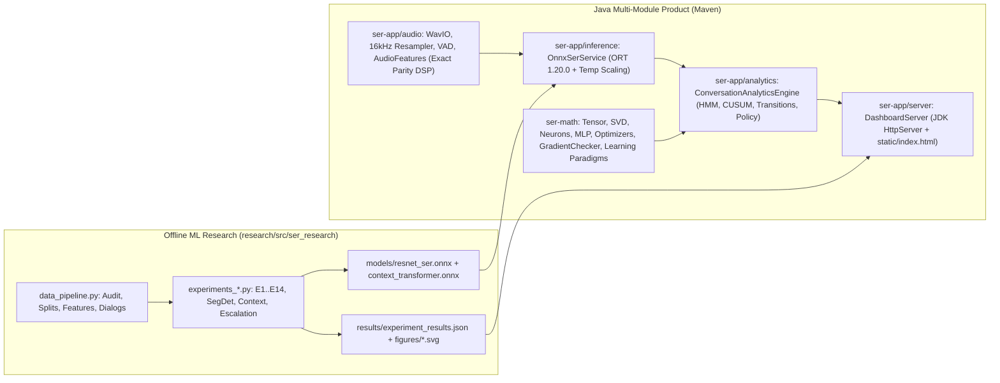

# Software Architecture Specification

## 1. System Overview
The solution separates **offline deep learning experimentation & ONNX export** (Python 3.13 + PyTorch) from the **production inference, mathematical sandbox, conversation analytics engine, and web dashboard** (Java 21 + Maven multi-module build + ONNX Runtime).

## 2. Module Responsibilities

### 2.1 `ser-math` (Zero-Dependency Mathematical Sandbox)
Package `edu.ser.math`:
- `Tensor`: Dense row-major N-D tensor supporting NumPy-style broadcasting, reshaping, permutation, inner/outer products, 2D/batched matmul, reductions, `conv2d`, `conv3d`, `maxPool2d`, `avgPool2d`, and exact multi-layer receptive-field calculations.
- `Svd`: One-sided Jacobi SVD ($A = U \Sigma V^T$) + low-rank spectrogram approximation.
- `Activations` & `Losses`: `Step`, `Sigmoid`, `Tanh`, `ReLU`, `LeakyReLU`, `Softmax`, `MSE`, `BCE`, and weighted `CrossEntropyLogits`.
- `Neurons`: `McCullochPittsNeuron` (AND/OR/NOT/NAND + inhibitory veto), `Perceptron`, and gradient-trained `SmoothNeuron`.
- `Mlp` & `Optimizers`: Multi-layer perceptron with `Zeros/Uniform/Xavier/He` init, `BatchNorm1D` (analytic backward pass), inverted `Dropout`, L1/L2 regularization, and `BatchGD / SGD / Momentum / Nesterov` optimizers.
- `GradientChecker`: Central finite-difference verification ($\epsilon = 10^{-5}$, relative error $< 10^{-6}$).
- `paradigms.LearningParadigms`: Pure Hebbian, Oja's rule (verified against SVD principal vector), Competitive SOM, Widrow-Hoff Delta/LMS, RBM (CD-1), and Hopfield energy network.
- `viz.SvgChartGenerator` & `demo.MathSandboxMain`: Exports SVG visualizations and JSON summaries to `results/math_sandbox/`.

### 2.2 `ser-app` (Production Audio, Inference, Analytics & UI)
- `edu.ser.app.audio.WavIO`: 16-bit PCM WAV decoding/validation, 48 kHz anti-aliased decimation & resampling to 16 kHz, stereo channel splitting (`Ch0 = CUSTOMER`, `Ch1 = AGENT`), energy+hangover VAD utterance segmentation, and acoustic event tagging (`HIGH_VOCAL_INTENSITY`, `SHORT_BURST`, `SUSTAINED_TURN`).
- `edu.ser.app.audio.AudioFeatures`: Exact Java mirror of `research/src/ser_research/features.py`:
  - `N_FFT = 512`, `HOP_LENGTH = 320` (20 ms), `N_FRAMES = 128` (2.572 s), `N_MELS = 64` HTK triangular filters (50–7600 Hz), `ln(Mel + 1e-6)` standardized by training-fold statistics, plus 20 orthogonal DCT-II MFCCs, 12 Chroma bins, F0 autocorrelation pitch, RMS energy, ZCR, and spectral centroid/rolloff.
- `edu.ser.app.inference.OnnxSerService`: Loads `resnet_ser.onnx`, `context_transformer.onnx`, and `model_metadata.json`, runs utterance and sequence inference, and applies calibrated temperature scaling.
- `edu.ser.app.analytics.ConversationAnalyticsEngine`: Computes utterance-level and conversation-level distributions, Markov transition matrix, stateful **CUSUM** drift score, **2-State HMM forward-filtered escalation probability**, risk indicators, and enforces **EU AI Act Art. 5(1)(f) Customer-Only Default Mode** (redacting agent vocal emotion inference unless explicitly run in `--research-mode`).
- `edu.ser.app.server.DashboardServer`: Serves the REST JSON API and static offline-safe HTML/SVG Web UI.

## 3. REST API Specification
| Endpoint | Method | Purpose |
|---|---|---|
| `/` | `GET` | Interactive Contact-Center Analytics & Research Web Dashboard |
| `/api/overview` | `GET` | Aggregate KPIs, emotion distribution, escalation rate, average RTF/latency |
| `/api/conversations` | `GET` | List of processed conversation summaries |
| `/api/conversations/{id}` | `GET` | Full utterance timeline, escalation curves, transition matrix, attention matrix |
| `/api/analyze` | `POST` | Upload WAV bytes (`X-Filename`) or `?sample=<file>` for real-time Java ONNX analysis |
| `/api/audio/{filename}` | `GET` | Stream `.wav` audio for dashboard playback |
| `/api/research` | `GET` | Live JSON from `results/dataset_stats.json`, `results/experiment_results.json`, `results/math_sandbox/summary.json`, `models/registry.json` |
| `/api/figures/{name}` | `GET` | Serve SVG benchmark and math sandbox figures |

## 4. Infrastructure & Build Decisions
- **Zero External Services Required**: Built on Maven 3.9.9 with project-local `.m2repo/`, JDK 21 `HttpServer`, and file-backed JSON artifacts (`results/`, `models/`), keeping deployment single-process (`java -jar ser-app/target/ser-app.jar`). PostgreSQL was intentionally omitted as unnecessary for single-node research analytics.
